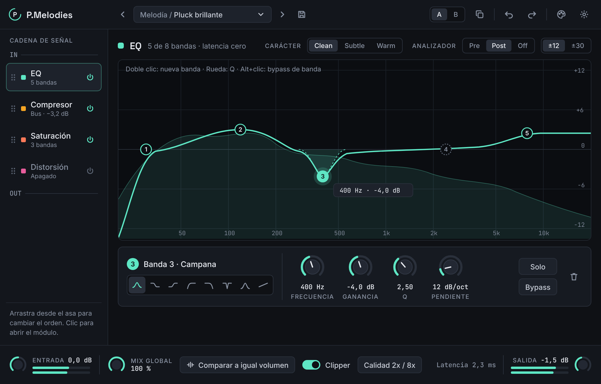

# P.Melodies

**ES** · Plugin VST3 para FL Studio que reúne en una sola ventana un EQ paramétrico, un compresor, una saturación multibanda y una distorsión, en una cadena que se reordena arrastrando los módulos.

**EN** · VST3 plugin for FL Studio that combines a parametric EQ, a compressor, multiband saturation and distortion in a single window, in a signal chain you reorder by dragging modules.

> **En desarrollo / Work in progress.** Todavía no hay versión descargable. / No downloadable build yet.

## Módulos / Modules

| Módulo | Qué hace |
|---|---|
| EQ | Hasta 8 bandas, edición directa sobre la curva, analizador de espectro, latencia cero |
| Compresor | 8 estilos, lookahead, hold, range, sidechain externo con EQ |
| Saturación multibanda | Hasta 6 bandas con 16 estilos analógicos, drive, feedback, dynamics y tono por banda |
| Distorsión | Hard clip, foldback, rectificador, fuzz, bitcrusher y downsample |

## Tecnología / Tech stack

C++20 · [JUCE 8](https://juce.com) · CMake · GitHub Actions (builds de Windows y validación con pluginval).

## Documentación / Docs

- [`PROMPT.md`](PROMPT.md) — especificación completa y plan de desarrollo por fases.
- [`docs/design/`](docs/design/) — referencias visuales de la interfaz.

## Licencia / License

[GNU AGPLv3](LICENSE).
